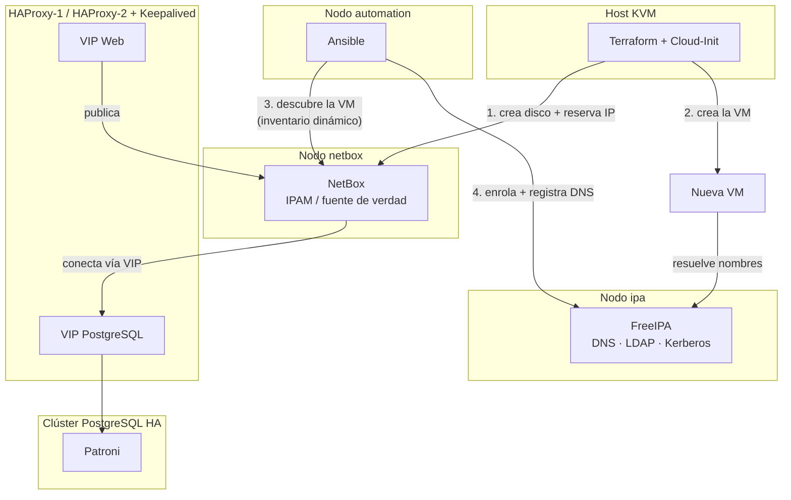

# Laboratorio de infraestructura: IaC + identidad + IPAM

Laboratorio personal de infraestructura como código (IaC) que
automatiza el aprovisionamiento y la configuración de nuevas máquinas
virtuales sobre KVM/libvirt, con identidad centralizada (FreeIPA),
IPAM (NetBox) y un clúster PostgreSQL en alta disponibilidad
(Patroni + HAProxy + Keepalived) como base para los propios servicios
del laboratorio.

## Objetivo

Antes de este proyecto, incorporar un nuevo servidor requería
configurar manualmente hostname, IP, DNS e instalación de servicios:
lento, propenso a errores y difícil de mantener homogéneo. El
objetivo es automatizar todo ese flujo de extremo a extremo:

```
Terraform → KVM → NetBox → Cloud-Init → Ansible → FreeIPA → DNS
```

Con un único comando (`./deploy_vm.sh <nombre>`), una VM nueva queda
creada, con IP reservada, configurada en su primer arranque,
administrable por Ansible, enrolada en FreeIPA y con su DNS (A/PTR)
publicado.

## Arquitectura



Cada pieza tiene una responsabilidad única:

| Componente | Función |
|---|---|
| **Terraform + Cloud-Init** | Aprovisionamiento de la VM (disco, red, usuario, claves SSH iniciales). Se ejecutan en el host KVM. |
| **Ansible** (`automation`) | Configuración posterior de la VM: enrolamiento en FreeIPA, tareas de administración recurrentes. |
| **NetBox** | Fuente de verdad de IPAM: qué IPs están usadas y por quién. Terraform reserva IPs aquí. |
| **FreeIPA** | Identidad, DNS, Kerberos. Resuelve nombres y publica dónde encontrar cada servicio. |
| **PostgreSQL + Patroni + HAProxy + Keepalived** | Base de datos en alta disponibilidad, reutilizada por NetBox y otros servicios. |

## Estructura del repositorio

```
.
├── terraform/lab/       # Aprovisionamiento de VMs (Terraform + Cloud-Init)
├── ansible/              # Configuración post-despliegue (Ansible + FreeIPA)
├── netbox/               # Configuración e instalación de NetBox
├── haproxy/               # Fragmentos de configuración de HAProxy
├── keepalived/            # Fragmentos de configuración de Keepalived
└── docs/
    ├── terraform.md
    ├── ansible.md
    ├── freeipa-dns.md
    └── netbox-ipam.md
```

Cada `docs/*.md` documenta el resultado final de esa pieza —no el
proceso de prueba y error con el que se construyó—, con la
arquitectura, las decisiones de diseño y cómo usarla.

## Requisitos previos

- Host KVM con `libvirt` y una plantilla base (`rocky9-template.qcow2`).
- Nodo `automation` con Ansible Core instalado, con acceso SSH sin
  contraseña al resto de nodos.
- FreeIPA operativo con las zonas DNS `lab.local` y su zona inversa.
- NetBox operativo con el prefijo de red y el pool de IPs para
  Terraform ya creados (ver `docs/netbox-ipam.md`).
- Un clúster PostgreSQL en alta disponibilidad (Patroni + HAProxy +
  Keepalived) si vas a reutilizarlo para NetBox u otros servicios.

## Uso rápido

```bash
cd terraform/lab
terraform init
cp terraform.tfvars.example terraform.tfvars   # rellena tus claves SSH reales
export NETBOX_API_TOKEN='...'

./deploy_vm.sh mi-nueva-vm
```

Ver `docs/terraform.md` para el detalle de qué hace cada paso.

## Seguridad y datos sensibles

Este repositorio está pensado para no contener secretos:

- `terraform.tfstate`, `*.tfvars` reales, `vault.yml` sin cifrar,
  `vault_pass` y `configuration.py` con datos reales están excluidos
  vía `.gitignore` en cada subcarpeta.
- Los tokens de API (NetBox) y contraseñas (PostgreSQL, FreeIPA
  admin) se pasan como variables de entorno o se cifran con Ansible
  Vault; nunca se escriben en los ficheros de código.
- Las IPs y nombres de dominio (`lab.local`, `192.168.10.0/24`) son
  los de un laboratorio privado — ajusta el `.gitignore` y revisa el
  historial de commits si vas a reutilizar este código contra una red
  real con requisitos de confidencialidad distintos.

## Estado del proyecto

Laboratorio personal en desarrollo activo. El flujo de creación de
una VM (Terraform → NetBox → Cloud-Init → Ansible → FreeIPA → DNS)
está validado de extremo a extremo, incluyendo gestión de múltiples
VMs (`for_each`) sin destruir las existentes.
